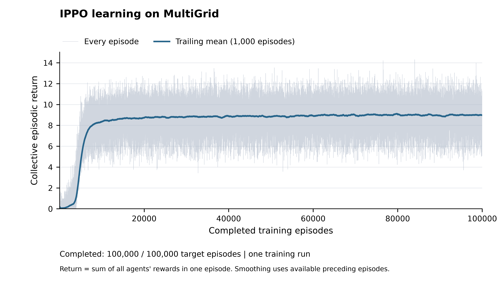
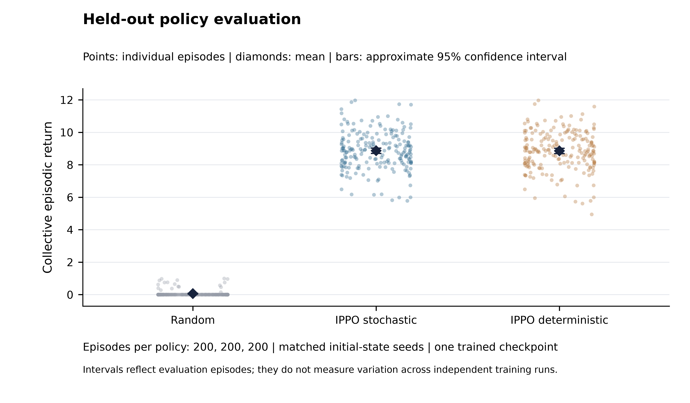
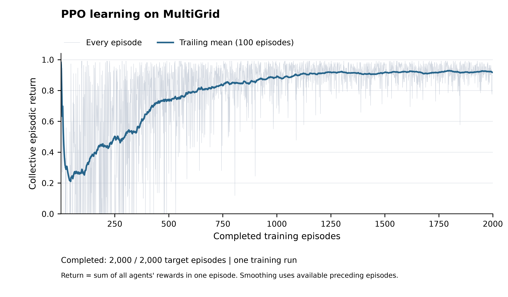

# PPO on MultiGrid: implementation and experiments

## Experiment status

The recorded independent PPO (IPPO) run completed **100,000 of 100,000 requested episodes**. The training log and final summary agree on completion.

There are 3 independently controlled agent(s), 10,000,000 recorded joint environment transitions, and 30,000,000 agent decisions. Measured training time was 13.29 minutes. All numerical results below are calculated from saved local logs.

## Task and environment

The environment is `MultiGrid-Cluttered-Fixed-15x15`. The required multi-agent task uses a 15 by 15 grid, three agents, 30 interior wall obstacles, a fixed goal at grid coordinate (13, 13), and a 100-step joint episode limit. Each agent receives only its own 5 by 5 partial view and its own heading. The seven discrete actions are turn left, turn right, move forward, pick up, drop, toggle, and done (a no-op in this task).

In the three-agent task, an agent that reaches the goal receives $r_t^i = 1 - 0.9t/100$ (using the environment's 1-based step counter) and respawns. Other agents receive no reward from that event. Reaching the goal does not end the joint episode; one agent can score repeatedly before the timeout. The sticky `env.done[i]` flag records whether the agent has succeeded at least once. It is not an absorbing termination signal for learning. Collective episodic return is $R_{\mathrm{team}} = \sum_{i=1}^{N}\sum_{t=0}^{T-1} r_t^i$. This sum is used for reporting, while each policy learns from its own rewards.

The obstacle layout uses seed 52. Episode and action-order randomness use per-environment seeded random generators, with varying starting positions. Wall-clock reseeding was removed so the experiment and evaluations can be reproduced. A cached observation path reuses only immutable wall/goal views and overlays the visible agents; regression tests compare it against the original observation construction, including occlusion and goal respawns.

## Independent PPO implementation

Each agent has its own actor-critic network, Adam optimizer, rollout buffer, rewards, advantages, and value targets. There is no policy sharing, centralized critic, or use of another agent's separate observation. Other agents can still be visible inside the agent's legitimate local field of view. Batched rollout inference stacks copies of the separate networks for speed; it does not mix or tie their trainable parameters.

The encoded grid contains categorical object, color/agent-identity, and state/direction IDs. Their one-hot dimensions are 11, 6, and 4 per visible cell. The 25 cells and four-way own-heading encoding give 529 input features. Two fully connected layers of 64 tanh units feed a categorical actor and a scalar critic. The actor and critic share the encoder within one agent, but no network weights are shared across agents.

For agent $i$, the probability ratio and clipped surrogate are

$$\rho_t^i(\theta_i)=\frac{\pi_{\theta_i}(a_t^i\mid o_t^i)}{\pi_{\theta_{i,\mathrm{old}}}(a_t^i\mid o_t^i)},$$

$$L_{\mathrm{clip}}^i=\mathbb{E}_t\left[\min\left(\rho_t^i\widehat A_t^i,\operatorname{clip}(\rho_t^i,1-\epsilon,1+\epsilon)\widehat A_t^i\right)\right].$$

The minimized loss combines the negative clipped objective, value loss, and an entropy bonus:

$$L^i=-L_{\mathrm{clip}}^i+c_vL_V^i-c_e\mathbb{E}_t[H(\pi_i(\cdot\mid o_t^i))].$$

Generalized advantage estimation uses the TD residual $\delta_t^i=r_t^i+\gamma m_tV_i(o_{t+1}^i)-V_i(o_t^i)$ and recursion $\widehat A_t^i=\delta_t^i+\gamma\lambda m_t\widehat A_{t+1}^i$. Actual terminations cut both bootstrapping and the advantage trace. For a time-limit truncation, the implementation adds the discounted value of the actual final observation to the training reward before cutting the trace. It never bootstraps from the next episode's reset observation. Logged returns always use the original environment reward, not this bootstrap adjustment. Goal respawns in the continuing multi-agent task do not cut the trace.

PPO updates shuffle each agent's own rollout into minibatches, normalize advantages within each minibatch, use clipped value loss when configured, and clip the gradient norm. Approximate KL can stop additional update epochs after an epoch exceeds the configured threshold. The learning rate is linearly annealed according to completed episodes.

## Training configuration

| Setting | Recorded value |
|---|---:|
| Training seed | 1 |
| Layout seed | 52 |
| Target joint episodes | 100000 |
| Parallel environment instances | 64 |
| Rollout horizon per environment | 128 |
| Hidden units per layer | 64 |
| Initial learning rate | 0.0003 |
| Discount gamma | 0.99 |
| GAE lambda | 0.95 |
| PPO clipping coefficient | 0.2 |
| Minibatches per update | 4 |
| Maximum update epochs | 4 |
| Entropy coefficient | 0.01 |
| Value coefficient | 0.5 |
| Gradient norm limit | 0.5 |
| KL early-stop threshold | 0.03 |
| Clipped value loss | True |
| Learning-rate annealing | True |
| Device | cpu |
| W&B logging mode | offline |

The training seed is one run, not a population of independent trained models. All completed episodes are preserved in `episodes.csv`. W&B reports rolling training summaries; the local CSV remains the source of truth. The offline training history was synchronized to W&B and verified against the local CSV: **1,000 logged points, one every 100 episodes**, through episode 100,000. All cloud return points match the corresponding local 100-episode means. The remote run is `finished`. [W&B run](https://forge.coreweave.com/wandb/311yanzhuo-jin299-medical-college-of-wisconsin/socialrl-ippo/runs/nksxtadt); [Cloud verification record](results/ippo_seed1/wandb_sync_status.json).

## Measured learning curve

The first 1,000 recorded episodes had mean collective return **0.0726**; the final 1,000 had mean **8.9730**, a change of **+8.9004**. These are descriptive windows from the same training run, not an independent-seed significance test.

| Agent | First-window mean return | Final-window mean return | Final-window success rate |
|---|---:|---:|---:|
| 0 | 0.0356 | 3.0016 | 99.6% |
| 1 | 0.0196 | 2.9930 | 99.2% |
| 2 | 0.0174 | 2.9784 | 99.0% |

Learning curve from every recorded training episode. The labeled trailing mean makes the trend easier to read; the raw episode returns are retained. No missing episodes are extrapolated.

## Held-out evaluation

The saved checkpoint after 100,000 episodes was evaluated on seeds 1,000,000 through 1,000,199. The same seeds were used for sampled policy actions, greedy policy actions, and independent uniform random actions. Policies were frozen throughout evaluation. Starting-state seeds were held out, while the fixed obstacle layout was the same as in training; this evaluates new episodes on the trained map, not generalization to unseen maps.

| Policy | Evaluation episodes | Mean collective return [95% CI] | Any-agent success | All-agent success |
|---|---:|---:|---:|---:|
| PPO, sampled actions | 200 | 8.8624 [8.7002, 9.0245] | 100.0% | 96.5% |
| PPO, greedy actions | 200 | 8.8514 [8.6851, 9.0176] | 100.0% | 96.5% |
| Uniform random actions | 200 | 0.0573 [0.0300, 0.0846] | 9.0% | 0.0% |

Return intervals use mean +/- 1.96 times the sample standard deviation divided by the square root of the evaluation episode count. They describe Monte Carlo uncertainty across evaluation episodes for one checkpoint. Success is reaching the goal at least once per agent; the full JSON also provides Wilson intervals for success probabilities.

| Policy | Agent | Mean individual return | Success rate |
|---|---:|---:|---:|
| Stochastic | 0 | 2.9538 | 99.0% |
| Stochastic | 1 | 3.0533 | 99.5% |
| Stochastic | 2 | 2.8553 | 98.0% |
| Deterministic | 0 | 2.9642 | 99.0% |
| Deterministic | 1 | 2.9921 | 99.5% |
| Deterministic | 2 | 2.8951 | 98.0% |
| Random | 0 | 0.0259 | 4.5% |
| Random | 1 | 0.0100 | 1.5% |
| Random | 2 | 0.0214 | 3.0% |

The stochastic policy's mean paired return difference relative to random actions was **8.8050 [8.6457, 8.9643]**. Pairing is by starting-state seed.

The deterministic policy's mean paired return difference relative to random actions was **8.7941 [8.6306, 8.9576]**. Pairing is by starting-state seed.

Held-out returns: each point is one episode; diamonds show policy means and bars show approximate 95% confidence intervals. Horizontal offsets only separate overlapping points.

## Trajectory evidence

The video renderer places the full grid beside every agent's own partial observation, the next action, the previous transition's reward, and the cumulative individual rewards. Frame $t$ shows state $s_t$ and proposed action $a_t$; the displayed return includes only transitions already completed before $a_t$. The full-grid display is for interpretation and is not an input to the policies.

Each video is the **first held-out episode**, selected in advance, with no filtering for high return or success.

- [trajectory deterministic seed1000000](results/ippo_seed1/evaluation/trajectory_deterministic_seed1000000.mp4)
- [trajectory_deterministic_seed1000000.gif](results/ippo_seed1/evaluation/trajectory_deterministic_seed1000000.gif)
- [trajectory_deterministic_seed1000000.json](results/ippo_seed1/evaluation/trajectory_deterministic_seed1000000.json)
- [trajectory stochastic seed1000000](results/ippo_seed1/evaluation/trajectory_stochastic_seed1000000.mp4)
- [trajectory_stochastic_seed1000000.gif](results/ippo_seed1/evaluation/trajectory_stochastic_seed1000000.gif)
- [trajectory_stochastic_seed1000000.json](results/ippo_seed1/evaluation/trajectory_stochastic_seed1000000.json)

## Single-agent debugging experiment

Before the full multi-agent run, PPO was checked on `MultiGrid-Cluttered-Fixed-Single-6x6-v0` for 2,000 episodes and 43,367 transitions. In this single-agent environment, goal success terminates the episode. It therefore differs from the three-agent continuing respawn task; its absolute returns are not a like-for-like multi-agent baseline.

| Policy | Evaluation episodes | Mean collective return [95% CI] | Any-agent success | All-agent success |
|---|---:|---:|---:|---:|
| PPO, sampled actions | 100 | 0.9327 [0.9231, 0.9422] | 100.0% | 100.0% |
| PPO, greedy actions | 100 | 0.8705 [0.8164, 0.9246] | 91.0% | 91.0% |
| Uniform random actions | 100 | 0.2952 [0.2228, 0.3676] | 47.0% | 47.0% |

Single-agent debugging curve. This separate experiment checks that the PPO implementation can learn before the full multi-agent run.

## Verification and limitations

The accompanying regression tests check environment shapes and seven-action semantics, per-agent goal rewards and respawning, independent seeded randomness, cached/reference observation parity, separate policy and rollout storage, batched/individual inference agreement, GAE boundary and timeout handling, exact episode counts, checkpoint continuation, evaluation reward accounting, paired evaluation seeds, and absence of policy updates during evaluation.

The recorded validation run passed **23 tests with 0 failures**. The final artifact audit passed **55 checks with 0 failures**. This includes checking the completed training budget, checkpoints, evaluation outputs and presentation artifacts. [Validation record](VALIDATION.json); [Detailed artifact audit](results/ippo_seed1/submission_audit.json).

Final figures and both trajectory videos were visually reviewed, with PDF text-size and collision checks saved beside the figures. [Figure and video QA record](results/ippo_seed1/figures/qa_summary.json).

The evidence is limited to one training seed and one fixed obstacle layout. Evaluation confidence intervals must not be interpreted as uncertainty across retrained models. The policy is feedforward under partial observability, so observations can alias different situations. Greedy action selection may behave differently from the stochastic training policy. A rise in collective return alone does not establish learned cooperation: agents optimize separate rewards and may differ in their individual success rates. Uniform random actions are a basic reference, not a comparison against other trained multi-agent methods. No state-of-the-art claim is made.

## External submission status

The code, checkpoints, measured results, figures, videos and this report are available locally. W&B cloud synchronization and verification are complete: [verified run](https://forge.coreweave.com/wandb/311yanzhuo-jin299-medical-college-of-wisconsin/socialrl-ippo/runs/nksxtadt). The completed source is published in the [GitHub fork](https://github.com/YanzhuoJin/multigrid) on branch `socialrl-complete`. The uploaded source commit `069a2247b433a88117a82235d7d1d6b7587020c8` was verified. [GitHub publication verification record](GITHUB_SUBMISSION.json).

## Reproduction and artifacts

Use the recorded configuration and the commands in the project README. The essential artifacts are:

- [Exact training configuration](results/ippo_seed1/config.json)
- [All measured training episodes](results/ippo_seed1/episodes.csv)
- [PPO update diagnostics](results/ippo_seed1/updates.jsonl)
- [Final independent actor-critic checkpoint](results/ippo_seed1/checkpoints/final.pt)
- [Individual held-out episode results](results/ippo_seed1/evaluation/episodes.csv)
- [Evaluation protocol and statistical summaries](results/ippo_seed1/evaluation/summary.json)

## References and attribution

1. Schulman et al. (2017). [*Proximal Policy Optimization Algorithms*](https://arxiv.org/abs/1707.06347).
2. Schulman et al. (2015). [*High-Dimensional Continuous Control Using Generalized Advantage Estimation*](https://arxiv.org/abs/1506.02438).
3. de Witt et al. (2020). [*Is Independent Learning All You Need in the StarCraft Multi-Agent Challenge?*](https://arxiv.org/abs/2011.09533).
4. [CleanRL PPO reference implementation](https://github.com/vwxyzjn/cleanrl/blob/master/cleanrl/ppo.py).
5. [Natasha Jaques' MultiGrid starter repository](https://github.com/natashamjaques/multigrid).

The supplied CleanRL-style PPO script is archived in `legacy/ppo_original.py`. Its clipped-PPO and GAE components informed the independent multi-agent implementation in `multiagent_metacontroller.py` and `ippo_agent.py`. The active `ppo.py` is a thin single-agent entry point into this same tested core; `main.py` is the main training entry point. Third-party copyright notices and source links are preserved in `THIRD_PARTY_NOTICES.md` and `LICENSE`. The StarCraft paper motivates independent PPO as a baseline; it is not evidence for the MultiGrid results reported here.
